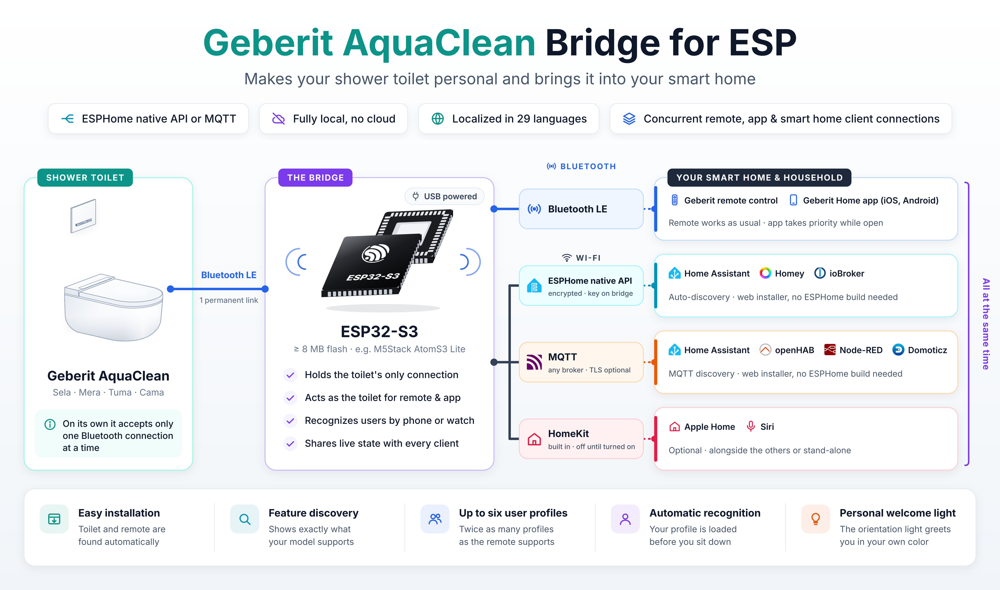
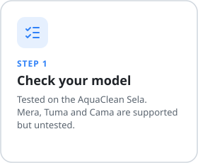
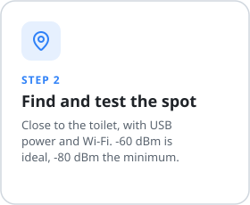
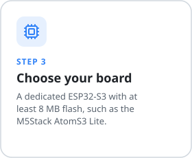
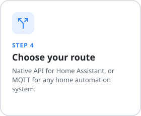
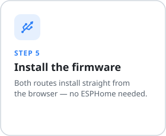
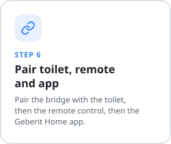
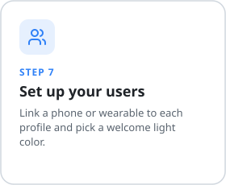
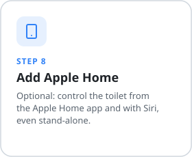

# Geberit AquaClean Bridge for ESP

<p align="center">
  
</p>

<p>
  <a href="https://github.com/barloew/geberit-aquaclean-bridge-for-esp/releases"></a>
  
</p>

<p>
  <a href="docs/routes.md"></a>
  <a href="docs/routes.md#homey"></a>
  <a href="docs/routes.md"></a>
  <br>
  <a href="#connecting-over-mqtt"></a>
  <a href="#connecting-over-mqtt"></a>
  <a href="#connecting-over-mqtt"></a>
  <a href="#connecting-over-mqtt"></a>
  <br>
  <a href="#apple-home-homekit-optional"></a>
</p>

**[Installation](#installation)** · **[Hardware](#hardware)** · **[Users](#users)** · **[Entities](#entities)** · **[Apple Home](#apple-home-homekit-optional)** · **[Languages](#languages)** · **[Disclaimer](#trademark--legal-disclaimer)**

**Geberit AquaClean Bridge for ESP** makes your **Geberit AquaClean shower toilet** personal and brings it into your smart home. It recognizes who is approaching and loads their personal profile automatically. No need to press a user key on the remote.

Out of the box, the Geberit AquaClean shower toilet supports only one Bluetooth connection at a time. Running on an ESP32, the Geberit AquaClean Bridge keeps one persistent, fully local connection to the toilet. It bridges it to Home Assistant over the ESPHome native API — also usable by other systems that speak it, such as Homey (via its ESPHome app) and ioBroker — or to any home automation system via MQTT, such as openHAB, Node-RED or Domoticz. It can also add Apple HomeKit support. Meanwhile, the AquaClean remote control and one Geberit Home app stay connected alongside it.

> [!IMPORTANT]
> The Geberit AquaClean Bridge requires a **dedicated ESP32-S3 with at least 8 MB flash** (see [Hardware](#hardware)), installed close to the Geberit AquaClean shower toilet. A Bluetooth signal strength of around -60 dBm is ideal; -80 dBm is the minimum. The spot also needs USB power and Wi-Fi (2.4 GHz). Check that this is possible at your location before you start.
>
> Validated on the **AquaClean Sela**. Mera, Tuma and Cama are supported through feature discovery. The AquaClean 4000 and the AquaClean Alba (Geberit's newer platform, Series 250) are not supported. See [Check your model](#step-1-check-your-model).

## Highlights

- **Easy installation.** For MQTT, install ready-made firmware in your language straight from the browser (Chrome or Edge, via USB); no ESPHome needed. For the ESPHome native API, start from the ready-made ESPHome example and set your board. Either way, the toilet and remote control are found automatically.
- **Personal welcome light.** The built-in orientation light becomes your personal greeting. Once you're recognized, it flashes in the color you picked for your profile. It's also a visual confirmation that your profile is loaded and ready.
- **Up to six user profiles.** That's twice as many profiles as the Geberit remote supports.
- **Automatic user recognition.** All six profiles are recognized by their linked smartphone, watch, wearable or tracker, even when it uses randomized MAC addresses. The Identity Resolving Key (IRK) can be captured by the Geberit AquaClean Bridge itself, or reused if it's already known in Home Assistant. Addresses are resolved on the ESP32 itself, so MAC address changes are picked up instantly. Profiles 1–3 can still be picked on the remote as well.
- **Personal control, whatever you use.** Once you're recognized, your profile is loaded before you sit down. Just press shower on the remote control, in Home Assistant or another home automation app, or in Apple Home: it runs with your settings, without picking a profile first. A profile key on the remote still overrides it.
- **Apple HomeKit and Siri (optional).** The bridge itself becomes an Apple Home accessory. It works alongside Home Assistant or MQTT, or completely stand-alone without any other home automation system. Control your toilet from the Home app or by voice with Siri.
- **Concurrent connections.** Home automation, HomeKit, the remote control and one Geberit Home app, all at the same time. While the app is open, it takes priority; commands from Home Assistant, MQTT and HomeKit keep working.
- **Automatic discovery.** Your Geberit AquaClean shower toilet is found automatically, along with the features and controls your model supports. Your home automation system shows exactly those, nothing more and nothing less.
- **Complete visibility and control.** Device characteristics, usage and maintenance status are available to your automations.
- **Physical maintenance, safely gated.** Descaling, arm cleaning, calibration and filter replacement are available from your home automation system, but only after you opt in and unlock them at the toilet with the remote. When you're done, they're hidden again.
- **Local and secure.** No cloud. Encrypted with the ESPHome API key, or MQTT over TLS when you build with ESPHome YAML.
- **29 languages.** Entities, options and logs follow Geberit's own terminology wherever it's available.

## Installation

<!-- steps:begin -->
<p align="center">
  <a href="#step-1-check-your-model"></a>
  <a href="#step-2-find-and-test-the-spot"></a>
  <a href="#step-3-choose-your-board"></a>
  <a href="#step-4-choose-your-route"></a>
</p>

<p align="center">
  <a href="#step-5-install-the-firmware"></a>
  <a href="#step-6-pair-toilet-remote-and-app"></a>
  <a href="#step-7-set-up-your-users"></a>
  <a href="#step-8-add-apple-home"></a>
</p>

### Step 1: Check your model

Find the article number on the type plate or in the Geberit Home app and look it up in [Models and feature discovery](#models-and-feature-discovery).

- **Validated:** AquaClean Sela.
- **Supported:** AquaClean Mera Comfort, Mera Classic (also floor-standing), Tuma Comfort and Tuma Classic (seat, complete and floor-standing), and Cama. Feature discovery shows only what your toilet supports.
- **Not supported:**
  - AquaClean 4000: it has no app and no remote control.
  - AquaClean Alba: it runs on Geberit's newer platform (Series 250), whose encrypted protocol v2 the bridge doesn't speak. There is a separate, experimental ESP bridge for the Alba in the [`series-250-bridge` branch](https://github.com/barloew/geberit-aquaclean-bridge-for-esp/tree/series-250-bridge).

Have a different model? See [Supporting other models](#supporting-other-models).

### Step 2: Find and test the spot

The bridge must be close to the toilet. The spot needs:

- **Bluetooth signal:** around -60 dBm is ideal, -80 dBm is the minimum.
- **Power and network:** USB power and Wi-Fi (2.4 GHz).

To test a spot before buying anything, use a Bluetooth scanner app on your phone (such as nRF Connect) and look for the toilet's signal strength. A phone antenna differs from an ESP32, so treat it as an estimate. Once installed, the toilet's **Toilet signal** diagnostic shows the real value.

### Step 3: Choose your board

The bridge needs an ESP32-S3 with **at least 8 MB flash**, dedicated to the bridge: one bridge per toilet, and no other Bluetooth components on the same board. The firmware is about 3.3 MB and needs two update slots, so 4 MB boards don't fit.

| Board | Package | Status |
|---|---|---|
| M5Stack AtomS3 Lite | `board-atoms3-lite.yaml` | Recommended, validated |
| M5Stack AtomS3R | `board-atoms3r.yaml` | Builds, not yet tested on hardware |
| Seeed XIAO ESP32S3 (also Plus) | `board-xiao-esp32s3.yaml` | Builds, not yet tested on hardware. Connect the included U.FL antenna. |

Other ESP32-S3 boards with at least 8 MB flash build too, but haven't been tested on hardware.

The web installer has firmware for all three. In ESPHome YAML, choose the board with the `board:` line, for example `.../packages/board-atoms3r.yaml@v1.36.0`. See [Hardware](#hardware) for status indicators and buttons per board.

### Step 4: Choose your route

Both routes give the same devices and entities. Pick one; never both.

| | Native API | MQTT |
|---|---|---|
| For | Home Assistant (ESPHome integration); also Homey, ioBroker | Home Assistant, openHAB, Node-RED, Domoticz, … |
| Install | ESPHome YAML | Web installer, no ESPHome needed (or ESPHome YAML) |
| Encryption | Noise (API key) | TLS, only when built with ESPHome YAML |
| Web interface on the ESP | No | Yes |
| Apple Home (HomeKit) | Optional, ESPHome YAML | Optional, ESPHome YAML only |

See [Two routes: ESPHome or MQTT](#two-routes-esphome-or-mqtt) for all differences.

### Step 5: Install the firmware

#### MQTT: web installer

The web installer installs the MQTT route. No ESPHome needed.

1. Open the [web installer](https://barloew.github.io/geberit-aquaclean-bridge-for-esp/) in Chrome or Edge and connect the board with USB.
2. Choose your [board](#hardware) and [language](#languages), press **Install** and enter your Wi-Fi in the same window. If the bridge knows no Wi-Fi later on, it opens the hotspot **AquaClean Setup**.
3. Press **Visit device**, or open `http://aquaclean-xxxxxx.local` (the last six characters are the end of the ESP's MAC address).
4. Under **AquaClean Bridge**, enter **MQTT broker**, **MQTT port** (1883), **MQTT user** and **MQTT password**, choose your **Time zone**, and press **Connect to MQTT broker**. The bridge stores the settings and restarts. The password is never shown again; to change the broker later, edit the fields and press the button again.
5. Connect your home automation system. See [Connecting over MQTT](#connecting-over-mqtt).

> [!IMPORTANT]
> The ready-made firmware has no password on its web page and on firmware updates, and no TLS: anyone on your network can open the page. For a password and encrypted MQTT, build the MQTT route with ESPHome YAML (`web_auth.yaml`, `mqtt_tls.yaml`, see [Packages](#packages)).

#### Native API: ESPHome YAML

1. Copy [`examples/atoms3-lite.yaml`](examples/atoms3-lite.yaml). It fits every board: set the `board:` line, `route: api` and your [language](#languages).
2. Fill in `secrets.yaml`: `wifi_ssid`, `wifi_password`, `aquaclean_ota_password` and `aquaclean_api_key`. Copy a random API key from the [ESPHome API documentation](https://esphome.io/components/api/), or run `openssl rand -base64 32`.
3. Flash it with ESPHome 2026.10 or newer.
4. Add the bridge in Home Assistant (ESPHome integration) with the same API key.
5. Allow it to perform Home Assistant actions: **Settings → Devices & services → ESPHome → Geberit AquaClean Bridge → Configure**. This is needed for notifications such as Show IRK and HomeKit pairing.

> [!NOTE]
> Only one bridge may run per toilet. Switch off any previous ESP first.

### Step 6: Pair toilet, remote and app

1. **Toilet.** Press **Pair with toilet** (Geberit AquaClean Bridge device), or hold the board button for 3 s. Switch the toilet off for about 30 s and on again. The bridge waits for the toilet's pairing window and pairs; the log shows *Toilet encrypted (newly paired as remote control)*.
2. **Remote control.** Switch on **Pair remote control** (Geberit AquaClean Bridge device) and hold **+** on the remote for about 30 s until it shows *Pairing ok*.
3. **Geberit Home app.** Remove the old toilet entry, then add the toilet again. When the app asks, long-press **+** on the remote. The bridge passes it on and the app connects within a second. You can add several phones (iOS and Android).

A new ESP has a new Bluetooth address, so after moving to new hardware all three steps are needed once.

### Step 7: Set up your users

For each of the up to six profiles:

1. **Name the user** (optional) with **User**.
2. **Link a device.** Press **Capture IRK** in the profile and pair your phone, watch or tracker with the bridge within two minutes. Or link a device Home Assistant already knows. See [Users](#users).
3. **Pick a welcome light color** with **Welcome light**.
4. **Tune the range** if needed with **User recognition signal strength**: -60 dBm by default, around -80 dBm for a phone in a pocket.

### Step 8: Add Apple Home

HomeKit works stand-alone too, without Home Assistant or any other home automation system. It is built in only with ESPHome YAML, not in the ready-made firmware of the web installer. Add this to your YAML and flash:

```yaml
geberit_aquaclean:
  homekit:
    enabled: true
```

Then add the accessory in the Home app with the setup code or QR code. The Home app warns about an uncertified accessory; that's expected. See [Apple Home](#apple-home-homekit-optional) for all options and how to find the setup code for each route.
<!-- steps:end -->

## Hardware

The bridge needs a **dedicated ESP32-S3 with at least 8 MB flash**: one bridge per toilet, and no other Bluetooth components on the same board. The web installer has firmware for every board below; in ESPHome YAML, pick your board with the `board:` line, for example `.../packages/board-atoms3r.yaml@v1.36.0`. On every board, holding the button for 3 s pairs the ESP with the toilet as remote control.

| Board | Package | Status |
|---|---|---|
| M5Stack AtomS3 Lite | `board-atoms3-lite.yaml` | Recommended, validated |
| M5Stack AtomS3R | `board-atoms3r.yaml` | Builds, not yet tested on hardware |
| Seeed XIAO ESP32S3 (also Plus) | `board-xiao-esp32s3.yaml` | Builds, not yet tested on hardware |

Other ESP32-S3 boards with at least 8 MB flash build too, but haven't been tested on hardware.

### M5Stack AtomS3 Lite

The RGB LED shows the status.

| LED | Meaning |
|---|---|
| green | toilet connected |
| cyan | remote control connected |
| blue | app connected |
| purple, blinking | pairing window for the remote control open |
| red, blinking | no connection to the toilet |
| two bright blinks in the profile's color | user recognized, profile loaded (welcome light) |
| two blinks green / red | IRK captured / nothing received |

### M5Stack AtomS3R

There is no RGB LED, so the whole screen shows the status, in the same colors as the AtomS3 Lite. The screen backlight is switched on at startup through the LP5562 chip. The button is the screen (GPIO41). The package enables the 8 MB octal PSRAM; the build is about 100 KB larger because of the screen.

### Seeed XIAO ESP32S3 / Plus

> [!IMPORTANT]
> Connect the included U.FL antenna. Without it, Wi-Fi and Bluetooth are weak.

A single orange LED shows the status as a pattern. The button is BOOT (GPIO0). The package enables the 8 MB octal PSRAM.

| LED | Meaning |
|---|---|
| dim, steady | toilet connected |
| bright, steady | app connected |
| fast blinking | pairing window open |
| slow blinking | no connection to the toilet |
| two bright flashes | user recognized (welcome light), or IRK capture finished. Without colors, success and failure look the same: check the log. |

## Two routes: ESPHome or MQTT

The MQTT route is installed with the web installer or with ESPHome YAML, the native API route with ESPHome YAML. In YAML, the route is a single key: the substitution `route: api` or `route: mqtt` in [`examples/atoms3-lite.yaml`](examples/atoms3-lite.yaml). Only that route is built; both give the same devices and entities. For controllers (Home Assistant, Homey, …) and install methods, see [docs/routes.md](docs/routes.md).

| | Route 1: ESPHome | Route 2: MQTT |
|---|---|---|
| Setting | `route: api` | `route: mqtt` |
| Install | ESPHome YAML | Web installer, or ESPHome YAML |
| Package | `packages/route_api.yaml` (= `api.yaml` + API key) | YAML: `packages/route_mqtt.yaml` (= `mqtt.yaml` + `web.yaml`; + `mqtt_tls.yaml` for TLS). Web installer: `mqtt.yaml` + `web.yaml` + `mqtt_setup.yaml` + `provisioning.yaml` |
| For | Home Assistant with the ESPHome integration; also Homey, ioBroker | Home Assistant via MQTT discovery, openHAB, Node-RED, Domoticz, … |
| Web interface on the ESP | No (Home Assistant shows everything) | Yes |
| Broker and time zone | – | YAML: substitutions. Web installer: on the bridge's web page |
| Encryption | Noise (API key) | TLS with certificate check (optional, YAML only) |
| Apple Home (HomeKit) | Optional | Optional, YAML only |
| Clock | From Home Assistant | SNTP (substitution `timezone`) |
| Linking a profile to a HA device | Directly | Via HA `mqtt_statestream` (see `packages/mqtt.yaml`) |
| Actions `aquaclean_link_user` / `aquaclean_set_irk` / `aquaclean_raw_request` | Yes | No (the link script and the **Enter IRK** field work in both) |

> [!WARNING]
> Never use both routes at once: your home automation system would show everything twice. The component refuses a configuration with both `api:` and `mqtt:`.

### Connecting over MQTT

The bridge announces itself with MQTT discovery (prefix `homeassistant`), so most platforms find all devices and entities by themselves. Homey is the exception (see below).

- **Home Assistant:** add the MQTT integration with your broker. Discovery is on by default; the bridge's devices appear under **Settings → Devices & services → MQTT**. <!-- TODO: equivalent of "Allow the device to perform Home Assistant actions" for the MQTT route -->
- **openHAB:** install the MQTT binding and add your broker as a Bridge Thing. The bridge's devices show up in the inbox through Home Assistant discovery.
- **Domoticz:** add the hardware *MQTT Auto Discovery Client Gateway with LAN interface* with your broker and auto-discovery prefix `homeassistant`.
- **Node-RED:** use `mqtt in` and `mqtt out` nodes on the bridge's topics. States are published under `<name>/<component>/<entity>/state`, commands go to `.../command`.
- **Homey:** the native API route (via a Homey ESPHome app) is the easiest. Over MQTT, Homey does not ingest Home Assistant discovery, so map the bridge's topics to Homey devices/flows by hand with the MQTT Client app. See [docs/routes.md](docs/routes.md#homey).

### Packages

| Package | What it adds | Native API | MQTT |
|---|---|---|---|
| `packages/web.yaml` | Web interface on the ESP (`http://<name>.local`): all entities grouped like the devices, the log, and firmware updates from the browser. Group names follow the language; set your own with `web_toilet`, `web_session` and `web_profile`. | Not needed: Home Assistant shows everything | Required |
| `packages/web_auth.yaml` | Password on the web interface (digest): `web_username`, `web_password`. The page stays HTTP; the ESP has no HTTPS server. | Only with `web.yaml` | Recommended |
| `packages/provisioning.yaml` | Wi-Fi setup in the browser (Improv over USB) and the hotspot **AquaClean Setup**. | Optional | Optional (in the web installer firmware) |
| `packages/mqtt_setup.yaml` | MQTT broker, port, user, password and time zone entered on the web page and stored on the ESP, instead of substitutions. Generated by `tools/gen_firmware.py`. | – | Optional (in the web installer firmware) |
| `packages/mqtt_tls.yaml` | Encrypted MQTT: `mqtt_ca` (CA certificate, PEM) and `mqtt_port: "8883"`. | – | Optional |

## Users

All six profiles have the same entities on the bridge: their shower settings, **Activate profile N settings**, **Store settings in profile N** (both in **Active session**), name, link and welcome light. They differ in where the settings live:

- **Profiles 1–3** are stored in the toilet, the same profiles as profile keys 1–3 on the remote control. The bridge reads them from the toilet and shows them; a change on the bridge is written to the toilet, and a change made with the remote (long press of a profile key stores the current settings) shows up on the bridge. A short press of the key loads the profile, as always.
- **Profiles 4–6** exist only on the bridge. The toilet doesn't know them; the bridge loads them by writing their settings into the session.

Recognition works for all six profiles. **Clear profile** empties a profile: name, link, welcome light and IRK, and for profiles 4–6 also the settings.

### Capture IRK (recommended)

For smartphones, smartwatches, wearables and trackers:

1. Press **Capture IRK** in the profile.
2. Pair the device with the bridge within two minutes:
   - **iPhone / Apple Watch:** Settings → Bluetooth, tap **AquaClean IRK**.
   - **Android:** first switch on **Capture IRK as Android keyboard** (under Geberit AquaClean Bridge), then pair **AquaClean Keyboard** in the Bluetooth settings.
3. The device hands over its Identity Resolving Key. The bridge stores it in the profile, removes the pairing again and blinks the board LED green (red: nothing received; on the XIAO's single-color LED both look the same, so check the log). You can then forget the *AquaClean IRK* device on the phone.

From then on the bridge recognizes the device by itself, also right after it changes its address and when the Geberit Home app connects from it. The profile shows the last digits under **IRK**. **Show IRK** sends the whole key to Home Assistant as a notification, for example to paste into Private BLE Device.

During the capture, the remote control and the app can't reach the toilet through the bridge. Based on the idea of irk-capture (MIT).

> [!CAUTION]
> An IRK is not an ordinary MAC address but a credential. Anyone who has it can recognize and follow your device, whatever address it uses. Treat it like a password: don't share it, don't post it in issues, and delete the **Show IRK** notification once you've used it. `log_obfuscate` masks keys in the log.

### Enter a known IRK

Already have the IRK of a device, for example from Private BLE Device, an earlier bridge or another tool? Enter it in the profile's **Enter IRK** field, in Home Assistant or on the bridge's web page. Both forms are accepted:

- **32 hex digits**, as **Show IRK** and Home Assistant's Private BLE Device show it (spaces, colons and an `irk:` prefix are ignored);
- **base64** (24 characters ending in `=`), as stored in the iOS keychain.

The bridge stores it like a captured IRK and recognizes the device from then on. The field always shows empty again, so the key isn't visible or published afterwards. An empty entry removes the stored IRK; a key in neither form is refused with a line in the log. In the native API route the action `esphome.<node>_aquaclean_set_irk` (`user`, `irk`) does the same.

### Link a device Home Assistant already knows

Add the script [`homeassistant/aquaclean_link_user.yaml`](homeassistant/aquaclean_link_user.yaml) to `scripts/` (with `!include_dir_merge_named`) or to `scripts.yaml`. Run it, choose the profile and the device tracker of a Private BLE Device (iPhone, Apple Watch) or an iBeacon (Companion app → BLE Transmitter). Choosing no device clears the link. The bridge follows the address Home Assistant knows and measures the signal itself. In the MQTT route this needs Home Assistant's `mqtt_statestream` (see `packages/mqtt.yaml`).

> [!TIP]
> A Private BLE Device is only matched once Home Assistant knows its current address. After the phone changes its address (about every 15 minutes) that can take a while. A captured IRK doesn't have this delay.

### When is a user recognized?

- **The linked device comes closer** than **User recognition signal strength** (default -60 dBm; phones in a pocket are often weaker, try about -80). The bridge loads the profile, and the orientation light and board LED blink twice in the **Welcome light** color. The same user is greeted and loaded at most once every 5 minutes.
- **The Geberit Home app connects** from the linked phone. The profile is not loaded; the app writes its own settings.
- **A profile key 1–3 is pressed** on the remote control. That user counts as recognized for two minutes; the toilet loads the profile itself.

Recognized and seated makes them the **Active user**. Each profile shows **Recognized**, **Seated** and **Signal**.

**You don't need to pick a profile.** Because the bridge has already loaded the recognized user's profile, a shower started with the remote control, from Home Assistant or another home automation system, or from Apple Home runs with that user's settings. A profile key on the remote control always wins: the toilet loads that profile, and if someone is seated, that profile's user becomes the active user. The Geberit Home app is the exception: it writes the settings of its own user profile when it starts a function.

Normally the bridge listens 30 ms of every 320 ms, so a phone is heard every few seconds. When a linked device is within 20 dB of the threshold, it listens 160 ms of every 320 ms for 20 s, so crossing the threshold is noticed within about a second (at most 60 s, then a 2-minute pause). A recognized user stays recognized while seated or while their device stays within 15 dB below the threshold, and is lost 30 s after that.

## Entities

Your home automation system shows nine devices, whichever route you use (names follow the language; English shown here), plus **Physical maintenance** while it is switched on.

| Device | Entities |
|---|---|
| **Geberit AquaClean Bridge** (the ESP) | Toilet connected, pair with toilet, pair / unpair remote control, user recognition signal strength, physical maintenance, restart. Web installer firmware: MQTT broker, port, user, password, connect to MQTT broker, time zone. Disabled by default: remote control forward / pass-through / firmware / address, search for a nearby toilet, discovery mode. |
| **AquaClean Toilet** | Orientation light (on/off, 7 colors, 5 levels), next descaling in, showers today, last descaling, number of descalings, descaling status and time left, error code, arm cleaning status, days until filter change. **Configuration:** default shower settings, light activation (off / on / automatic / time-controlled), color, brightness, run-on time, two time windows, water hardness, demo mode. **Diagnostics:** model, article number, serial number, production date, commissioning, device type, firmware, toilet signal, address, reconnections, connected since, last error code, arm cleaning status, spray calibration, showers until unlock, descaling requested since, registration. Disabled by default: the discovery entities (raw status, last response, toilet advertisement, procedures seen, scan settings). |
| **Active session** | User detected, shower / Lady shower active, start/stop buttons, stop shower and dryer, spray intensity and arm position (both showers), water temperature, oscillating spray, activate / store profile 1–6, remote control connected and button event, Geberit Home app connected, recognized user, active user. |
| **User profile 1–6** | The profile's shower settings, clear profile, user, Home Assistant device, welcome light, capture IRK, enter IRK, recognized, seated, signal. **Diagnostics:** IRK (last four digits), show IRK. |

Seat heating, dryer, odor extraction, the automatic lid, pre-flush, WC water heating and accessibility mode exist on other models; [feature discovery](#models-and-feature-discovery) hides them on models without them. Light sensor sensitivity is on the Sela.

- **Flush** and **automatic flush** need Geberit's interface module for the flush actuation, except on the floor-standing Mera where it is built in. They appear on the Mera Comfort and Classic, the Sela (from 2019, optional) and the Tuma Comfort complete system (optional) once the bridge sees the module. On the Sela, flushing is supported but not validated: the Sela it was validated on has no interface module. The Tuma Classic and the Alba have no flush actuation.
- **Draining** appears only on the Cama (from the app's data points). The Sela (from 2019), Mera and Tuma refresh and drain the water themselves; only the old boiler models (AquaClean 4000, 5000, 8000, Sela before 2019) have a drain screw.
- **Connected modules**, **arm offsets** and **arm position adjustment** are disabled by default.
- The **trial period** sensors appear only on the Cama test set (146.30x), a Geberit trial unit that isn't sold.

Spray intensity, arm position and brightness are shown 1–5, like on the remote control. A water temperature of 0 means heating off.

Shower, Lady shower and dryer only start while someone is seated, whichever way you start them: the toilet blocks the arms otherwise, so the bridge refuses the command with a line in the log instead of sending it for nothing. Odor extraction can be started at any time, just like with its button on the remote control.

Settings don't need anyone seated. Session settings can be written before sitting down; the toilet keeps them for the next session (that's how a recognized user's profile is loaded in advance). Profiles can be changed and stored at any time, from the bridge or the app. Only the quick store on the front of the remote control (long press of a profile key) stores the settings that are active at that moment, so in practice that one is used while seated.

All ids come from the data point table of the Geberit Home app 2.14.2 (see [`docs/protocol.md`](docs/protocol.md)); those of the Sela are validated on a toilet.

### Renaming or hiding entities

Every entity can be renamed or hidden in the YAML by its key. The keys are listed under `names` in [`components/geberit_aquaclean/lang/en.yaml`](components/geberit_aquaclean/lang/en.yaml).

```yaml
geberit_aquaclean:
  water_hardness:
    name: Hardness
    disabled_by_default: true
```

## Physical maintenance

Procedures that need someone at the toilet are in a separate device, **Physical maintenance**: start, continue and cancel descaling, unlock the shower, arm cleaning (start, next step), spray calibration, lid calibration and opening angle, filter replaced, and on other models draining and arm position adjustment. The entities that tell you maintenance is due (next descaling in, error code, arm cleaning status, filter) stay with the toilet.

> [!WARNING]
> Only use these functions while you are at the toilet yourself, and follow the Geberit operating instructions. Make sure nobody sits on the toilet or can use it during a procedure. Descaling uses descaling agent: follow its instructions and keep it away from children, skin and eyes. The spray arm, dryer arm and lid can move unexpectedly. Water, possibly hot, and hot air from the dryer can come out of the toilet onto people nearby or on the seat: risk of scalding, slipping and water damage. The toilet is connected to water and mains power: never open it; draining can release water.
>
> A procedure started from a distance cannot be supervised. An interrupted or wrongly confirmed step can damage the toilet or lock the shower until the descaling is completed. Unlocking the shower or resetting counters without doing the maintenance hides a real need for it. You use these functions at your own risk; this project is not made by Geberit, and claims under warranty or liability towards Geberit, and the service terms of your installer and/or service provider, may be affected. The authors accept no liability for any injury or damage, including scalding, slipping or water damage.

To use it:

1. Read the warning and set `maintenance_disclaimer_accepted: "true"` (as a substitution, or directly under `geberit_aquaclean:`), then install. Without it the device can't be shown at all.
2. At the toilet, long-press the maintenance key on the remote control. The device appears, with the warning as a notification (otherwise in the log). Your home automation system briefly loses the bridge and reconnects to load the new entities.
3. It's hidden again after 60 minutes, with another long press of the maintenance key, with the **Physical maintenance** switch under the bridge, or when the ESP restarts.

While it's hidden, the bridge refuses maintenance commands, also from actions and raw requests. In the MQTT route, the ESP restarts to show or hide it. The long press of the maintenance key also reaches the toilet as usual.

## Apple Home (HomeKit, optional)

The bridge itself can be an Apple Home accessory. It works alongside Home Assistant or MQTT, or completely stand-alone without any other home automation system. It appears as one accessory with up to four switches; only those your toilet has:

| Switch | Works |
|---|---|
| Shower | Only while someone is seated; the bridge refuses it otherwise and the switch turns back off |
| Lady shower | Only while someone is seated, as above |
| Dryer | Only while someone is seated, as above (the toilet blocks the dryer arm otherwise) |
| Odor extraction | At any time, also without anyone seated, like the button on the remote control. After use it runs on for the run-on time set on the toilet (about 2 minutes by default) |

A started shower runs with the settings of the profile that is loaded, so with those of the recognized user. It uses Espressif's esp-homekit-sdk (non-commercial HomeKit Accessory Protocol, no MFi), so the Home app warns about an uncertified accessory. HomeKit is built in only with ESPHome YAML; the web installer firmware doesn't include it.

```yaml
geberit_aquaclean:
  homekit:
    enabled: true              # only then is HomeKit built in (default: false)
    setup_code: "215-73-480"   # optional; default: derived from the MAC address (see the log)
    # port: 32042
    # reset_pairings: true     # forget all Apple Home pairings once after flashing; set back to false afterwards
```

`mdns` must stay enabled. To pair, get the setup code or QR code:

- **Native API route:** while the bridge isn't paired, Home Assistant shows the notification *AquaClean: pair with HomeKit* with the setup code and QR code. **Show HomeKit QR code** sends it again, for example after removing the accessory in the Home app.
- **MQTT route** (with `packages/web.yaml`): the page `http://<ESP>/homekit` shows the setup code and QR code, behind the web interface password if set.

Then in the Home app: **Add accessory** → scan the QR code, or **More options** → the accessory → enter the setup code.

A switch that did nothing returns to the real state after about 6 s (20 s after switching off, while the arm retracts). HomeKit's own messages only appear at log level `VERBOSE`; pairing, removal and warnings are always shown.

At most 4 Apple devices can have the accessory open at the same time; see [Connections](#connections).

**Cost:** about 130 KB more flash and 4 KB static RAM, plus the HomeKit tasks and sessions at runtime. On the AtomS3 Lite with the native API route, about 95 KB of RAM stays free, and at least 55 KB at the busiest moment. Without a `homekit:` block, or with `enabled: false`, nothing of it is built in.

## Connections

| Bluetooth (max. 4) | At the same time |
|---|---|
| Toilet | 1: the toilet's only connection, held by the bridge |
| Remote control | 1 |
| Geberit Home app | 1 active. Several phones can be paired. |
| Free | 1, used temporarily for capturing an IRK |

| Network | At the same time |
|---|---|
| ESPHome API | Up to 5 clients. Home Assistant uses 1, the ESPHome dashboard log 1. |
| MQTT | 1 broker connection, plus the web server |
| HomeKit | Up to 4 open connections and 16 paired controllers. An Apple device only keeps a connection open while the Home app is open; a home hub (Apple TV or HomePod) always keeps 1 open. |

How they work together:

- **Remote control and app stay connected side by side.** The bridge keeps advertising as the toilet after every connection, so the app can connect while the remote is connected, and the other way around.
- **The remote control works as usual.** Screens and buttons pass unchanged to the toilet and back, also while the app is open.
- **The app takes priority.** While the app is connected, the bridge pauses its own status polls so the app doesn't slow down; your home automation system reads along with what the app requests, and commands from Home Assistant, MQTT and HomeKit still work. When the app closes, polling resumes and the bridge sets the clock again.
- **Simultaneous presses** on the remote and in the app are carried out by the toilet in the order they arrive, just like without the bridge.

## Models and feature discovery

After the first connection, the bridge finds out which functions the toilet has and shows only those entities:

- **Model:** the article number (e.g. 146.22x.xx.1) is looked up in a table built from Geberit's model overview. The **Model** sensor shows the name, e.g. *AquaClean Sela* or *AquaClean Tuma Comfort (seat)*.
- **Confirmation by the toilet:** every setting id an entity uses is read once. An empty answer means the toilet doesn't have it.
- An entity is shown when its function belongs to the model and the toilet confirms it. For an unknown article number, only the toilet's answers count.

The result is stored. ESPHome can't add or remove entities while running, so when the result differs from what is shown, the bridge restarts once (when nobody is seated and the app isn't connected). **Rediscover functions** runs the discovery again, for example after moving the bridge to another toilet.

The **In this bridge** column: ✓ supported (Series 248 protocol); ✗ not reachable or not this protocol. The functions are listed for every model, including the ones this bridge can't talk to.

| Model | Article | Functions | In this bridge |
|---|---|---|---|
| AquaClean Mera Comfort (Series 248) | 146.21x | All except light sensor: also orientation light, heated seat, dryer, odor extraction, automatic lid. Flush actuation with the interface module | ✓ |
| AquaClean Mera Classic | 146.20x, floor-standing 146.24x | Lady shower, oscillation, water temperature, spray arm, descaling, user detection, dryer, odor extraction. Flush actuation with the interface module (built in on the floor-standing version) | ✓ |
| AquaClean Sela | 146.22x | Orientation light with light sensor, Lady shower, oscillation, water temperature, spray arm, descaling, user detection. Flush actuation with the interface module (optional, from 2019; supported, not validated) | ✓ validated |
| AquaClean Tuma Comfort | Seat 146.27x, complete 146.29x, floor-standing 146.31x | As Mera Classic, plus heated seat. Flush actuation only on the complete system, with the interface module | ✓ |
| AquaClean Tuma Classic | Seat 146.07x, complete 146.09x, floor-standing 146.32x | Oscillation, water temperature, spray arm, descaling | ✓ |
| AquaClean Cama | 146.34x | Water temperature, descaling, user detection | ✓ |
| AquaClean Cama test set | 146.30x | As the Cama (a Geberit trial unit with an expiry date, not a model for sale) | ✓ as a Cama |
| AquaClean 4000 | 146.13x | None: no app and no remote control, can't be reached | ✗ not reachable |
| **AquaClean Alba** | 146.350, 146.351 | Shower only — jet strength (5 levels) and oscillation on the remote; arm position (5 levels), water temperature (5 levels) and water heating in the app; descaling; SoftClosing (mechanical) lid. No lady shower, dryer, odor extraction, orientation light or flush actuation. | ✗ Series 250 |

**Series 250 (Alba)** is not supported here: the Geberit Home app runs it on its newer platform with the encrypted **protocol v2**, unlike the cleartext Series 248 protocol that this bridge speaks. The functions above are listed so you know what the model does, but this ESP component cannot talk to it. A separate, experimental dual-role ESP bridge for the Alba lives in the [`series-250-bridge` branch](https://github.com/barloew/geberit-aquaclean-bridge-for-esp/tree/series-250-bridge) (its own ESP-IDF/NimBLE firmware); see [`docs/models.md`](docs/models.md) for the Alba's datapoints.

The Sela is validated on a toilet. The other Series 248 models are supported: their ids come from the Geberit Home app, which uses the same protocol for all Series 248 models, and feature discovery shows what each toilet has. See [`docs/models.md`](docs/models.md) for the entities per model.

## Supporting other models

Newer or other AquaClean models may advertise and answer differently. The discovery entities (disabled by default; Discovery mode under the bridge, the rest under the toilet) help you find out what a model supports, without a sniffer:

| Entity | Shows |
|---|---|
| Discovery mode | Logs every message (also the app's) and collects the following |
| Raw status | All 12 status values; unknown indexes show up here first |
| Toilet advertisement | Name, manufacturer data and services the toilet advertises |
| Procedures seen | Which requests the app uses, and how often |
| Scan settings → Settings scan | Which setting ids 00–1f answer for every kind (session 07, default 53, common 51, schedule 57); values in the log |
| Last response | Answer to a raw request |

Raw requests can be sent from Home Assistant (native API route) with the action `esphome.<node>_aquaclean_raw_request` (context, procedure and args as hex strings, e.g. `context: "01"`, `procedure: "53"`, `args: "0103"`).

A practical route for a new model:

1. Enable discovery mode, use the app for a few minutes and note **Procedures seen**.
2. Run **Scan settings** and compare the answering ids with `ENTITIES` in `__init__.py`.
3. Change a setting in the app or on the remote control and look for the matching write in the log.
4. Add the new setting to `ENTITIES` (kind, id, maximum) and a name in every language file.

Please [open an issue](https://github.com/barloew/geberit-aquaclean-bridge-for-esp/issues) with the discovery output of your model.

## Languages

Entity names come from `lang/<language>.yaml` and follow the terms of Geberit's own user manuals. The language is set only by `language:` in the YAML, or by the choice in the web installer: entity names, option texts (colors, activation, water hardness, button names), status texts, the log and the HomeKit names all follow it. To change it, change the YAML and build again, or install the firmware in the other language. Automations that compare option texts must use the texts of that language.

| Code | Language | Code | Language | Code | Language |
|---|---|---|---|---|---|
| `en` | English | `sv` | Swedish | `ro` | Romanian |
| `nl` | Dutch | `nb` | Norwegian (or `"no"`) | `ru` | Russian |
| `de` | German | `fi` | Finnish | `sk` | Slovak |
| `fr` | French | `pt` | Portuguese | `sl` | Slovenian |
| `it` | Italian | `ar` | Arabic | `sr` | Serbian (Latin) |
| `es` | Spanish | `tr` | Turkish | `uk` | Ukrainian |
| `pl` | Polish | `et` | Estonian | `zh` | Chinese (simplified) |
| `cs` | Czech | `hr` | Croatian | `ko` | Korean (also `kr`) |
| `hu` | Hungarian | `lv` | Latvian | `he` | Hebrew (also `iw`) |
| `da` | Danish | `lt` | Lithuanian |  |  |

> [!NOTE]
> Write `"no"` in quotes: YAML reads a bare `no` as false (which is accepted too).

The terms of the newer languages come from the translations Geberit ships in the Geberit Home app; the rest is translated with the same terms and hasn't been checked by native speakers. The Geberit Home app has no Arabic or Hebrew: the Arabic texts are our own, and the Hebrew texts follow the terms on geberit.co.il and in Geberit Israel's AquaClean brochure.

Arabic, Hebrew, Russian, Ukrainian, Chinese and Korean use no Latin letters, while ESPHome builds the entity key from the name. Their entities therefore keep the key of the English name and show the translated name, so entity ids stay readable and unique. With MQTT, topics are built from the name at runtime, so entity names stay English for these languages; option texts and the log are still translated.

**Adding a language:** copy `lang/en.yaml` (and optionally `lang/log/nl.json` for the log texts), translate it, add the code at the end of `LANGUAGES` in `__init__.py` and raise `LANGUAGE_COUNT` in `entities.h`.

## Notes and troubleshooting

- **Finding the toilet.** `toilet_mac` is optional. Without it, the bridge looks for Geberit toilets, waits 10 s and takes the one with the strongest signal. **Search for a nearby toilet** forgets it and searches again. Other bridges advertise like a toilet too, so place each bridge closest to its own toilet or set `toilet_mac`.
- **Finding the remote control.** `remote_mac` is optional. The device that pairs while **Pair remote control** is on is stored as the remote control; **Unpair remote control** removes it.
- **Requirements.** ESPHome 2026.10 or newer, with ESP-IDF.
- **Updating.** Web installer: install the new version from the same page without erasing the device (settings stay), or upload the `.ota.bin` on the bridge's web page. ESPHome YAML: change the version in the `github://…@vX.Y.Z` lines and install. With a local copy of the project, use **Clean Build Files** in the ESPHome dashboard after replacing it, otherwise ESPHome may keep building old files. See [`CHANGELOG.md`](CHANGELOG.md) for what changed.
- **Orientation light changes** are written to both the stored and the active value, so the light changes at once, also when the change comes from the app.
- **Logs.** The bridge keeps no log files: the log is a live stream (dashboard, web interface). The component's log follows `language:`; ESPHome's own messages stay English. `ble_device_base: INFO` under `logger: logs:` hides ESPHome's messages about other Apple devices nearby.
- **Sharing a log in a public issue.** Set `log_obfuscate: "true"` (substitution) to mask Bluetooth addresses, user names, linked devices, the serial number and keys down to their last four characters. Copy the log from the bridge's web interface: the `[S]` lines of the ESPHome log viewer are not masked.
- **Timeouts.** An unanswered request is retried once before it counts; a single missed status poll is left to the next poll. Around 1% missed polls is normal with Wi-Fi and Bluetooth on one radio.
- **Bond watchdog.** If the bond with the toilet disappears while connected, the bridge reconnects within 30 s.
- **Protocol.** The protocol is described in [`docs/protocol.md`](docs/protocol.md); its sources are listed in [`docs/SOURCES.md`](docs/SOURCES.md).

## Trademark & Legal Disclaimer

This project is an independent, unofficial open-source initiative and is **not** affiliated with, endorsed, sponsored, or supported by **Geberit AG** or any of its group companies.

**Geberit**, **AquaClean**, and all related product names, trade names, logos, and marks are trademarks or registered trademarks of **Geberit AG** and/or its group companies.

Any use of these names or marks in this repository is solely for **nominative and descriptive purposes**, such as identifying compatible hardware, models, or protocols. It does not imply any official association, partnership, or approval. All other trademarks remain the property of their respective owners.

The logos of ESPHome, Home Assistant, Homey, ioBroker, openHAB, Node-RED, Domoticz, MQTT and Espressif in the overview image and the badges belong to their owners. They are used unmodified, only to show compatibility, and are not covered by this project's license; no Geberit, Apple, Bluetooth or Wi-Fi logos are used. See [Logos](THIRD_PARTY_NOTICES.md#logos).

The Node-RED icon is by **Nick O'Leary** (OpenJS Foundation), licensed under [CC BY 3.0](https://creativecommons.org/licenses/by/3.0/). It is used unmodified.

This software is provided "as is", without warranty of any kind. Use at your own risk. To the extent permitted by law, the authors accept no liability for any injury or damage arising from its use, including scalding, slipping, water damage or damage to the toilet. Using unofficial software with your device may affect its manufacturer warranty and the service terms of your installer and/or service provider.

## License

See [LICENSE](LICENSE). Third-party components, embedded assets and trademark notices are listed in
[THIRD_PARTY_NOTICES.md](THIRD_PARTY_NOTICES.md).
